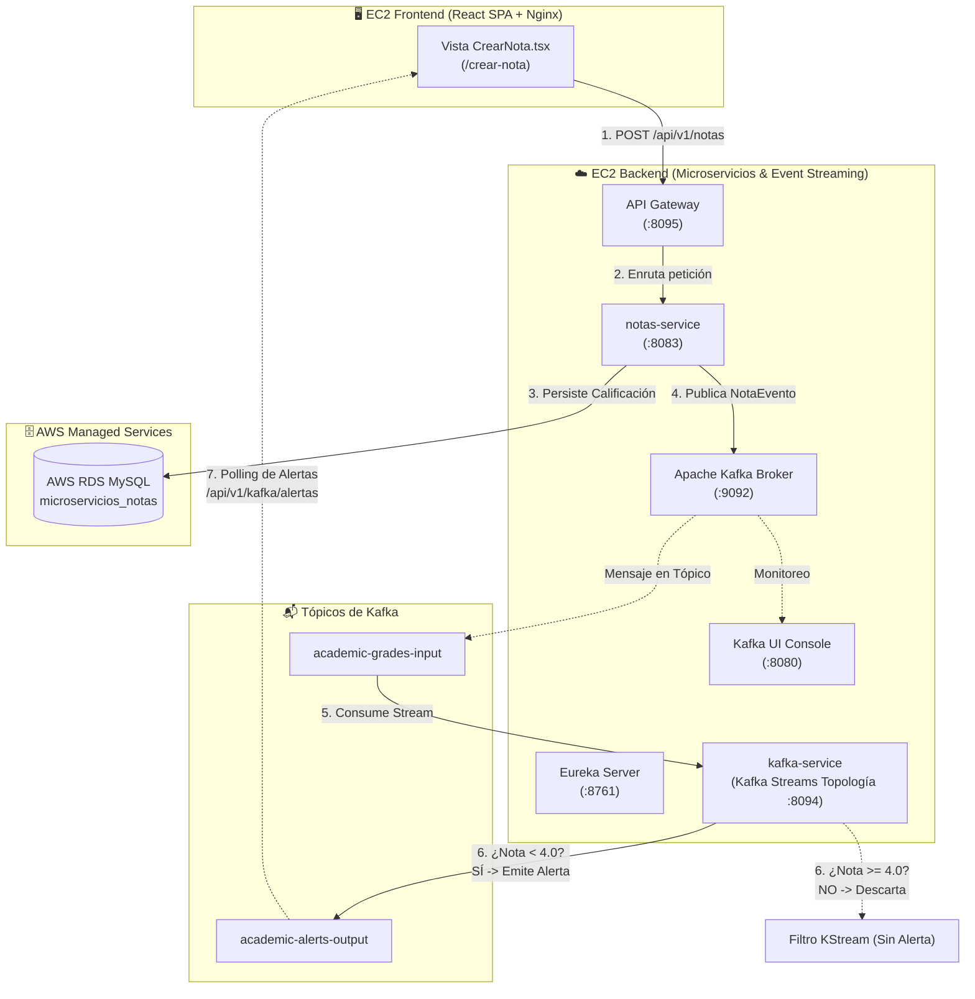
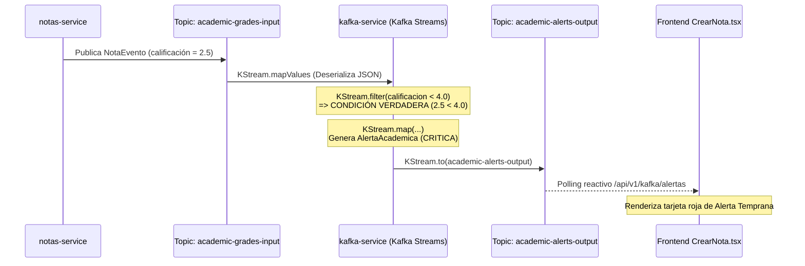

# 📘 Manual de Usuario y Guía de Pruebas: Pipeline de Eventos en AWS
### Microservicios Académicos con Apache Kafka, Kafka Streams, Docker y Terraform

---

## 📑 Tabla de Contenidos

1. [Visión General de la Arquitectura de Eventos](#-visión-general-de-la-arquitectura-de-eventos)
2. [Paso 1: Despliegue de Infraestructura en AWS (Terraform + Docker)](#1-pasos-de-despliegue-en-aws-terraform--docker)
   - [1.1 Requisitos Previos](#11-requisitos-previos)
   - [1.2 Inicialización y Aplicación con Terraform](#12-inicialización-y-aplicación-con-terraform)
   - [1.3 Extracción de Llave SSH Privada](#13-extracción-de-llave-ssh-privada)
   - [1.4 Obtención de Elastic IPs y URLs de Acceso](#14-obtención-de-las-elastic-ips-generadas)
   - [1.5 Verificación del Inicio Automático (user_data & Docker Compose)](#15-verificación-del-inicio-automático-vía-user_data)
3. [Paso 2: Verificación de Servicios en la Nube](#2-verificación-de-servicios-en-la-nube)
   - [2.1 Comprobación en Eureka Service Discovery (:8761)](#21-verificación-en-el-servidor-eureka-8761)
   - [2.2 Monitoreo y Validación en Kafka UI (:8080)](#22-acceso-y-monitoreo-en-kafka-ui-puerto-8080)
   - [2.3 Opciones de Conectividad (IP Pública vs. Túnel SSH)](#23-opciones-de-conectividad-ip-pública-vs-túnel-ssh)
4. [Paso 3: Prueba del Flujo End-to-End Paso a Paso](#3-prueba-del-flujo-end-to-end-paso-a-paso)
   - [3.1 Acceso al Frontend SPA (`CrearNota.tsx`)](#31-acceso-a-la-interfaz-del-frontend)
   - [3.2 Escenario A: Nota Aprobatoria (Calificación ≥ 4.0)](#32-escenario-a-nota-aprobatoria--40)
   - [3.3 Escenario B: Nota Deficiente con Alerta en Tiempo Real (Calificación < 4.0)](#33-escenario-b-nota-deficiente--40---alerta-en-tiempo-real)
5. [Paso 4: Comandos Útiles de Monitoreo y Debugging en EC2](#4-comandos-útiles-de-monitoreo-y-debugging-en-ec2)
   - [4.1 Acceso SSH a la Instancia Backend](#41-conexión-ssh-a-la-instancia-backend)
   - [4.2 Monitoreo de Logs en Tiempo Real](#42-monitoreo-de-logs-en-tiempo-real-con-docker-compose)
   - [4.3 Verificación de la Base de Datos RDS MySQL](#43-verificación-directa-en-aws-rds-mysql)
   - [4.4 Inspección de Kafka mediante CLI en Contenedor](#44-inspección-de-tópicos-mediante-kafka-cli)
   - [4.5 Matriz de Solución de Problemas (Troubleshooting)](#45-matriz-de-solución-de-problemas-troubleshooting)

---

## 🏛️ Visión General de la Arquitectura de Eventos

El sistema implementa una **Arquitectura Orientada a Eventos (EDA - Event-Driven Architecture)** sobre **Amazon Web Services (AWS)** utilizando **Apache Kafka** y **Kafka Streams**:



---

## 1. Pasos de Despliegue en AWS (Terraform + Docker)

### 1.1 Requisitos Previos

Antes de ejecutar el despliegue, asegúrate de contar con:
- **AWS CLI** instalado y configurado con credenciales válidas (`aws configure`).
- **Terraform** (versión `~> 1.5` o superior).
- Acceso a Internet y permisos de administrador en la cuenta AWS (VPC, EC2, RDS, Security Groups, EIPs).

### 1.2 Inicialización y Aplicación con Terraform

1. Abre tu terminal (PowerShell en Windows o Bash en Linux/macOS) y sitúate en la carpeta `Terraform` del proyecto:
   ```powershell
   cd Terraform
   ```

2. Inicializa los proveedores y plugins de Terraform:
   ```bash
   terraform init
   ```
   > **Salida esperada:** `Terraform has been successfully initialized!`

3. Genera y revisa el plan de ejecución de infraestructura:
   ```bash
   terraform plan
   ```
   Este comando validará los recursos a crear:
   - 1 Base de Datos **AWS RDS MySQL** (`encargo-bitacora-db`).
   - 2 Instancias **AWS EC2** (Ubuntu 22.04 LTS: Backend `t2.medium` y Frontend `t2.micro`).
   - 2 **Elastic IPs (EIP)** estáticas públicas asociadas a cada EC2.
   - Grupos de Seguridad (**Security Groups**) con reglas de entrada para puertos `22`, `80`, `443`, `8080` (Kafka UI), `8095` (Gateway) y `8761` (Eureka).
   - Generación automática de par de llaves SSH RSA de 4096 bits.

4. Aplica los cambios para aprovisionar toda la infraestructura en la nube:
   ```bash
   terraform apply -auto-approve
   ```
   > ⏳ *Nota de tiempo:* El despliegue de RDS y la creación de instancias toma entre 5 y 10 minutos.

---

### 1.3 Extracción de Llave SSH Privada

Terraform genera automáticamente una llave SSH segura para acceder a las instancias. Extráela a un archivo local `.pem`:

#### En Windows (PowerShell):
```powershell
terraform output -raw ec2_ssh_private_key > deploy_key.pem
# Configurar permisos para evitar advertencias de SSH:
icacls deploy_key.pem /inheritance:r
icacls deploy_key.pem /grant:r "$($env:USERNAME):(R)"
```

#### En Linux / macOS:
```bash
terraform output -raw ec2_ssh_private_key > deploy_key.pem
chmod 400 deploy_key.pem
```

---

### 1.4 Obtención de las Elastic IPs Generadas

Una vez finalizado el comando `terraform apply`, consulta los outputs con las direcciones IP públicas asignadas:

```bash
terraform output
```

La salida mostrará un resumen similar al siguiente:

```text
api_gateway_invoke_url = "https://xxxxxxxx.execute-api.us-east-1.amazonaws.com"
backend_public_ip      = "54.210.120.45"
frontend_public_ip     = "3.85.210.90"
frontend_url           = "http://3.85.210.90"
kafka_ui_url           = "http://54.210.120.45:8080"
eureka_dashboard_url   = "http://54.210.120.45:8761"
db_host                = "encargo-bitacora-db.xxxxxx.us-east-1.rds.amazonaws.com"
```

> 📌 **Guarda estos valores:**
> - `backend_public_ip`: Reemplazará `<BACKEND_IP>` en las instrucciones.
> - `frontend_public_ip`: Reemplazará `<FRONTEND_IP>` en las instrucciones.

---

### 1.5 Verificación del Inicio Automático vía `user_data`

Las instancias EC2 cuentan con un script de inicialización (`user_data`) embebido en Terraform que ejecuta automáticamente las siguientes tareas al encenderse:

1. **Configuración de memoria SWAP:** 4 GB en Backend y 2 GB en Frontend para soportar compilación y múltiples contenedores.
2. **Instalación de herramientas base:** Docker CE, Docker Compose Plugin, Git, JDK 17 y Maven.
3. **Clonación del repositorio:** Descarga la rama `Develop`.
4. **Inyección de variables de entorno:** Genera el archivo `/home/ubuntu/app/.env` con la conexión a RDS MySQL y los parámetros de Microsoft Entra ID.
5. **Compilación y empaquetado:** Compila los servicios Java si no existen JARs previos y construye las imágenes Docker.
6. **Orquestación con Docker Compose:** Ejecuta `docker compose -f docker-compose.prod.yml up -d`.

#### ¿Cómo validar que el aprovisionamiento terminó con éxito en la EC2 de Backend?
Conéctate por SSH a la EC2 de Backend y revisa la bitácora de inicialización del sistema:

```bash
ssh -i deploy_key.pem ubuntu@<BACKEND_IP>
```

Una vez dentro, ejecuta:
```bash
# Ver el log en vivo de cloud-init:
sudo tail -f /var/log/cloud-init-output.log
```
> Cuando veas el mensaje final indicando que los contenedores se iniciaron y `cloud-init finished`, el sistema estará 100% operativo.

Para listar el estado de todos los contenedores en ejecución:
```bash
cd /home/ubuntu/app
sudo docker compose -f docker-compose.prod.yml ps
```

---

## 2. Verificación de Servicios en Nube

### 2.1 Verificación en el Servidor Eureka (:8761)

Spring Cloud Netflix Eureka administra el registro y descubrimiento de los microservicios del ecosistema.

1. Abre tu navegador web e ingresa a:
   ```text
   http://<BACKEND_IP>:8761
   ```
2. Aparecerá el panel **Spring Eureka System Status**.
3. Dirígete a la sección central: **"Instances currently registered with Eureka"**.
4. Valida que los siguientes servicios clave figuren en estado **`UP`**:
   - `NOTAS_SERVICE` (puerto interno `8083`)
   - `KAFKA-SERVICE` (puerto interno `8094`)
   - `GATEWAY` (puerto interno `8095`)
   - `RABBITMQ-SERVICE`, `ASIGNATURAS_SERVICE`, `GRUPOS_SERVICE`, etc.

| Application Name | AMIs | Availability Zones | Status |
| :--- | :--- | :--- | :--- |
| **NOTAS_SERVICE** | n/a (1) | (1) | **UP (1) - 172.18.0.x:notas_service:8083** |
| **KAFKA-SERVICE** | n/a (1) | (1) | **UP (1) - 172.18.0.x:kafka-service:8094** |
| **GATEWAY** | n/a (1) | (1) | **UP (1) - 172.18.0.x:gateway:8095** |

> ✅ Si ambos servicios (`NOTAS_SERVICE` y `KAFKA-SERVICE`) están registrados en Eureka, la comunicación interna y el enrutamiento a través del Gateway operan con normalidad.

---

### 2.2 Acceso y Monitoreo en Kafka UI (Puerto 8080)

Kafka UI (provectuslabs) ofrece una consola visual para monitorear el cluster de Apache Kafka, tópicos, mensajes y grupos de consumidores.

1. Abre tu navegador e ingresa a:
   ```text
   http://<BACKEND_IP>:8080
   ```
2. En el menú superior izquierdo, confirma que el cluster seleccionado sea **`production-cluster`** y que su estado indique **Online** con 1 Broker activo.
3. Haz clic en la sección lateral **Topics**.
4. Verifica la existencia de los dos tópicos centrales del flujo académico:
   - 📥 **`academic-grades-input`**: Tópico de entrada donde `notas-service` publica cada calificación registrada.
   - 🚨 **`academic-alerts-output`**: Tópico de salida donde la topología de `kafka-service` (Kafka Streams) publica las alertas para notas inferiores a `4.0`.

```text
Kafka UI Dashboard
└── Topics
    ├── academic-grades-input   (Replication: 1, Partitions: 1)
    └── academic-alerts-output  (Replication: 1, Partitions: 1)
```

5. Haz clic en la sección **Consumers** para verificar que la aplicación de Kafka Streams esté suscrita:
   - Consumer Group: `academic-pipeline-app` (estado `STABLE` o `EMPTY` esperando mensajes).

---

### 2.3 Opciones de Conectividad (IP Pública vs. Túnel SSH)

El grupo de seguridad de Terraform (`encargo-backend-sg`) incluye reglas para acceder directamente a los puertos `8080` (Kafka UI) y `8761` (Eureka). Sin embargo, si deseas mantener un esquema de **acceso privado reforzado** sin exponer estos puertos a internet, puedes usar un túnel SSH:

```bash
# Redirige el puerto local 8080 al 8080 de la EC2 y el 8761 al 8761 de la EC2
ssh -i deploy_key.pem -L 8080:localhost:8080 -L 8761:localhost:8761 ubuntu@<BACKEND_IP>
```
Con el comando anterior activo en tu terminal, podrás ingresar directamente a través de:
- Kafka UI: `http://localhost:8080`
- Eureka: `http://localhost:8761`

---

## 3. Prueba del Flujo End-to-End (Paso a Paso)

A continuación, ejecutaremos dos escenarios para validar de forma integral el pipeline reactivo de eventos.

### 3.1 Acceso a la Interfaz del Frontend

1. Abre tu navegador web e ingresa a la URL del Frontend:
   ```text
   http://<FRONTEND_IP>
   ```
2. En la barra de navegación superior, haz clic en la opción **"Streaming Notas (Kafka)"** o navega directamente a la ruta:
   ```text
   http://<FRONTEND_IP>/crear-nota
   ```
3. Esta vista (`CrearNota.tsx`) presenta:
   - **Formulario de Registro:** ID de Estudiante, Asignatura, Calificación (1.0 - 7.0) y Ponderación.
   - **Panel de Historial de Notas:** Muestra las últimas calificaciones enviadas a través del Gateway.
   - **Panel de Alertas en Tiempo Real:** Realiza sondeo reactivo a Kafka Streams para reflejar inmediatamente alertas académicas generadas ante calificaciones deficientes.

---

### 3.2 Escenario A: Nota Aprobatoria (≥ 4.0)

En este escenario se evalúa el comportamiento regular: la nota se almacena en la base de datos MySQL, se emite el evento al tópico de entrada de Kafka y el motor de streaming valida que **NO** amerita emitir una alerta temprana.

#### Paso A.1: Registrar la nota en el Frontend
En el formulario de `CrearNota.tsx`, ingresa los siguientes valores de prueba:
- **ID de Estudiante (Integrante):** `1`
- **Asignatura:** `Arquitectura de Software`
- **Calificación:** `5.5`
- **ID de Ponderación:** `1`
- Haz clic en el botón **"Registrar Nota y Publicar Evento"**.

```text
[Formulario]
ID Estudiante : 1
Asignatura    : Arquitectura de Software
Calificación  : 5.5
Ponderación   : 1
Acción        : [ Registrar Nota y Publicar Evento ]
```

*Resultado en pantalla:*
Aparece una alerta verde de confirmación:
> *"Nota 5.5 guardada en MySQL y publicada en Kafka exitosamente. (Aprobatoria >= 4.0, no requiere alerta crítica)."*

---

#### Paso A.2: Verificar el tránsito por API Gateway y `notas-service`
La solicitud viaja a través del siguiente canal HTTP:
1. Navegador del cliente realiza: `POST http://<FRONTEND_IP>/api/v1/notas` (proxy Nginx).
2. Nginx reenvía hacia: `http://<BACKEND_IP>:8095/api/v1/notas` (Spring Cloud Gateway).
3. El Gateway enruta al microservicio destino `notas-service:8083`.

Para comprobarlo en los logs de la EC2:
```bash
sudo docker compose -f docker-compose.prod.yml logs --tail=20 notas-service
```
Verás la traza:
```text
INFO  [notas_service] c.d.n.s.NotaService : Evento NotaEvento enviado exitosamente a Kafka. 
Tópico: academic-grades-input, Key (ID Estudiante): 1, Evento: {"idNota":...,"idEstudiante":1,"nota":5.5,"calificacion":5.5,"asignatura":"Arquitectura de Software",...}
```

---

#### Paso A.3: Confirmar la persistencia en AWS RDS MySQL
Desde la consola SSH de la EC2 Backend, verifica que el registro se guardó en la tabla `notas` de la base de datos `microservicios_notas` alojada en AWS RDS:

```bash
# Obtén la dirección del RDS desde el archivo .env o la variable DB_HOST
source /home/ubuntu/app/.env

# Consulta el último registro guardado
mysql -h $DB_HOST -u $DB_USERNAME -p$DB_PASSWORD microservicios_notas \
  -e "SELECT idNota, nota, idPonderacion, idIntegrante FROM notas ORDER BY idNota DESC LIMIT 1;"
```

*Salida esperada:*
```text
+--------+------+---------------+--------------+
| idNota | nota | idPonderacion | idIntegrante |
+--------+------+---------------+--------------+
|     14 |  5.5 |             1 |            1 |
+--------+------+---------------+--------------+
```

---

#### Paso A.4: Comprobar el evento en Kafka UI y validar ausencia de alerta
1. Ve a Kafka UI: `http://<BACKEND_IP>:8080`.
2. Haz clic en **Topics** > **`academic-grades-input`** > pestaña **Messages**.
3. Confirma que existe un mensaje nuevo con:
   - **Key:** `"1"`
   - **Payload:**
     ```json
     {
       "idNota": 14,
       "idEstudiante": 1,
       "idIntegrante": 1,
       "nota": 5.5,
       "calificacion": 5.5,
       "asignatura": "Arquitectura de Software",
       "idPonderacion": 1
     }
     ```
4. Ahora dirígete a **Topics** > **`academic-alerts-output`** > pestaña **Messages**.
5. **Comprobación:** Confirma que **NO** se generó ningún mensaje nuevo para esta nota, ya que el filtro de Kafka Streams descartó la calificación por ser `≥ 4.0`.
6. En los logs de `kafka-service`:
   ```bash
   sudo docker compose -f docker-compose.prod.yml logs --tail=20 kafka-service
   ```
   Verás que el mensaje se procesó en el stream pero la condición de alerta no se activó.

---

### 3.3 Escenario B: Nota Deficiente (< 4.0) - Alerta en Tiempo Real

En este escenario se evalúa la detección proactiva: se registra una nota reprobatoria (roja), la cual debe desencadenar la topología reactiva de **Kafka Streams** y generar una **Alerta Temprana** en el tópico de salida.

#### Paso B.1: Registrar una nota deficiente desde el Frontend
En el formulario de `CrearNota.tsx`:
- **ID de Estudiante (Integrante):** `1`
- **Asignatura:** `Arquitectura de Software`
- **Calificación:** `2.5` *(nota inferior a 4.0)*
- **ID de Ponderación:** `1`
- Haz clic en **"Registrar Nota y Publicar Evento"**.

*Resultado en pantalla:*
Aparece el mensaje de confirmación destacando:
> *"Nota 2.5 registrada en MySQL y enviada a Kafka (Topic: academic-grades-input). ¡Atención: Nota < 4.0 procesada por el pipeline de Kafka Streams para generar Alerta Temprana!"*

---

#### Paso B.2: Verificar la llegada a `academic-grades-input` en Kafka UI
1. Abre Kafka UI en `http://<BACKEND_IP>:8080/ui/clusters/production-cluster/all-topics/academic-grades-input/messages`.
2. Observa el mensaje entrante:
   - **Offset:** incrementado en 1.
   - **Key:** `"1"`.
   - **Value:**
     ```json
     {
       "idNota": 15,
       "idEstudiante": 1,
       "idIntegrante": 1,
       "nota": 2.5,
       "calificacion": 2.5,
       "asignatura": "Arquitectura de Software",
       "idPonderacion": 1,
       "fechaCreacion": "2026-10-29T16:45:00.000"
     }
     ```

---

#### Paso B.3: Reacción inmediata de Kafka Streams (`kafka-service`)
En milisegundos, el componente `PipelineTopology.java` en `kafka-service` ejecuta la siguiente secuencia de operadores en el flujo:



Revisa los logs del contenedor en la EC2:
```bash
sudo docker compose -f docker-compose.prod.yml logs --tail=25 kafka-service
```

*Traza capturada:*
```text
WARN  [kafka-service] c.d.k.t.PipelineTopology : ¡ALERTA ACADÉMICA DETECTADA! Nota deficiente: 2.5 para estudiante: 1 en asignatura: Arquitectura de Software
INFO  [kafka-service] c.d.k.t.PipelineTopology : Emitiendo alerta académica al tópico 'academic-alerts-output': Key=1, Payload={"idAlerta":"4bf8e90a-xxxx-4xxx-xxxx-xxxxxxxxxxxx","idEstudiante":1,"idNota":15,"asignatura":"Arquitectura de Software","calificacion":2.5,"nivelAlerta":"CRITICA","mensaje":"Alerta Temprana: El estudiante ID 1 obtuvo calificación reprobatoria de 2.5 en Arquitectura de Software (< 4.0). Requiere seguimiento académico.","fechaAlerta":"2026-10-29T16:45:01"}
```

---

#### Paso B.4: Validar la publicación de la alerta en Kafka UI
1. En Kafka UI, navega a:
   **Topics** > **`academic-alerts-output`** > pestaña **Messages**.
2. Verifica que el mensaje de alerta fue emitido con éxito:
   - **Key:** `"1"`
   - **Value:**
     ```json
     {
       "idAlerta": "4bf8e90a-7b3f-4e0d-9b38-21d49e1e5b12",
       "idEstudiante": 1,
       "idNota": 15,
       "asignatura": "Arquitectura de Software",
       "calificacion": 2.5,
       "nivelAlerta": "CRITICA",
       "mensaje": "Alerta Temprana: El estudiante ID 1 obtuvo calificación reprobatoria de 2.5 en Arquitectura de Software (< 4.0). Requiere seguimiento académico.",
       "fechaAlerta": "2026-10-29T16:45:01"
     }
     ```

---

#### Paso B.5: Comprobación visual en el Frontend
Regresa a la pestaña de tu navegador con la vista de **`CrearNota.tsx`**:
- Observa la sección inferior derecha **"Alertas Tempranas en Tiempo Real (Kafka Streams)"**.
- Notarás que aparece automáticamente una tarjeta con borde rojo y badge **`CRÍTICA`**:
  - **Asignatura:** Arquitectura de Software
  - **Estudiante:** ID 1
  - **Calificación:** 2.5
  - **Mensaje:** *"Alerta Temprana: El estudiante ID 1 obtuvo calificación reprobatoria de 2.5 en Arquitectura de Software (< 4.0)..."*

*(Opcional)* Puedes comprobar el endpoint REST de alertas directamente mediante `curl`:
```bash
curl -s http://<BACKEND_IP>:8095/api/v1/kafka/alertas | jq .
```

---

## 4. Comandos Útiles de Monitoreo y Debugging en EC2

### 4.1 Conexión SSH a la Instancia Backend

Desde la carpeta donde guardaste tu llave privada `deploy_key.pem`:

```bash
# Conectar a la EC2 de Backend
ssh -i deploy_key.pem ubuntu@<BACKEND_IP>

# Conectar a la EC2 de Frontend (si requieres inspeccionar Nginx)
ssh -i deploy_key.pem ubuntu@<FRONTEND_IP>
```

---

### 4.2 Monitoreo de Logs en Tiempo Real con Docker Compose

Una vez dentro de la instancia de Backend (`cd /home/ubuntu/app`):

```bash
# 1. Monitorear logs en vivo del procesador de eventos (Kafka Streams):
sudo docker compose -f docker-compose.prod.yml logs -f kafka-service

# 2. Monitorear logs del microservicio de notas (productor Kafka):
sudo docker compose -f docker-compose.prod.yml logs -f notas-service

# 3. Monitorear logs del API Gateway:
sudo docker compose -f docker-compose.prod.yml logs -f gateway

# 4. Monitorear logs del broker de Apache Kafka:
sudo docker compose -f docker-compose.prod.yml logs -f kafka

# 5. Monitorear logs de Zookeeper:
sudo docker compose -f docker-compose.prod.yml logs -f zookeeper

# 6. Ver estado de todos los contenedores y puertos expuestos:
sudo docker compose -f docker-compose.prod.yml ps
```

---

### 4.3 Verificación Directa en AWS RDS MySQL

Puedes conectarte al motor de base de datos relacional MySQL desde la consola de la EC2:

```bash
# Conectarse a la consola interactiva de MySQL
mysql -h <RDS_ENDPOINT> -u admin -pBitacoraSegura2026 microservicios_notas

# Consultar esquema y últimas calificaciones:
USE microservicios_notas;
SHOW TABLES;
DESCRIBE notas;
SELECT * FROM notas ORDER BY idNota DESC LIMIT 10;
EXIT;
```

---

### 4.4 Inspección de Tópicos mediante Kafka CLI

Si deseas inspeccionar los mensajes directamente desde la línea de comandos sin abrir el navegador:

```bash
# Consumir mensajes en tiempo real desde el tópico de entrada:
sudo docker exec -it kafka kafka-console-consumer.sh \
  --bootstrap-server localhost:9092 \
  --topic academic-grades-input \
  --from-beginning \
  --property print.key=true

# Consumir mensajes en tiempo real desde el tópico de alertas:
sudo docker exec -it kafka kafka-console-consumer.sh \
  --bootstrap-server localhost:9092 \
  --topic academic-alerts-output \
  --from-beginning \
  --property print.key=true

# Listar todos los tópicos creados en el broker:
sudo docker exec -it kafka kafka-topics.sh \
  --bootstrap-server localhost:9092 \
  --list
```

---

### 4.5 Matriz de Solución de Problemas (Troubleshooting)

| Síntoma / Problema | Causa Probable | Solución Paso a Paso |
| :--- | :--- | :--- |
| **No se puede acceder a Kafka UI (`:8080`) o Eureka (`:8761`)** | El Security Group de AWS bloquea el tráfico entrante o el contenedor no ha terminado de iniciar. | 1. Valida las reglas de entrada del Security Group `encargo-backend-sg` en AWS.<br>2. Comprueba si el contenedor está corriendo: `sudo docker compose -f docker-compose.prod.yml ps`.<br>3. Como alternativa inmediata, abre un túnel SSH: `ssh -i deploy_key.pem -L 8080:localhost:8080 ubuntu@<BACKEND_IP>`. |
| **La nota no aparece en `academic-grades-input`** | El microservicio `notas-service` no pudo conectarse a Kafka al arrancar. | 1. Revisa los logs: `sudo docker compose -f docker-compose.prod.yml logs notas-service`.<br>2. Verifica que la variable `KAFKA_BOOTSTRAP_SERVERS: kafka:9092` esté configurada.<br>3. Reinicia el servicio: `sudo docker compose -f docker-compose.prod.yml restart notas-service`. |
| **Kafka Streams no genera alerta ante nota < 4.0** | El tópico de entrada o salida no coincide, o el formato del JSON no pudo ser deserializado. | 1. Inspecciona los logs: `sudo docker compose -f docker-compose.prod.yml logs kafka-service`.<br>2. Busca mensajes de error tipo `Error al deserializar evento de nota desde JSON`.<br>3. Comprueba el estado de la aplicación Streams mediante: `curl -s http://localhost:8094/api/v1/kafka/estado`. |
| **Frontend muestra error al intentar guardar la nota** | Nginx o el API Gateway no pueden enrutar la petición a `notas-service`. | 1. Revisa los logs del Gateway: `sudo docker compose -f docker-compose.prod.yml logs gateway`.<br>2. Verifica en Eureka (`:8761`) que `NOTAS_SERVICE` figure registrado y con estado `UP`.<br>3. Comprueba la conectividad de red interna de Docker: `docker network inspect backend`. |

---

## 🎯 Conclusión y Criterios de Aceptación Cumplidos

El presente manual y las pruebas detalladas garantizan la validación de:
1. **Infraestructura como Código (IaC):** Despliegue reproducible con Terraform de redes, seguridad, almacenamiento relacional (RDS) y cómputo (EC2).
2. **Aprovisionamiento automatizado:** Configuración sin intervención humana a través de `user_data` y Docker Compose.
3. **Persistencia Políglota y Desacoplamiento:** Almacenamiento transaccional en MySQL junto a distribución asíncrona mediante Apache Kafka.
4. **Procesamiento de Eventos en Tiempo Real:** Filtrado y emisión reactiva de alertas académicas tempranas con Kafka Streams.
5. **Observabilidad Integral:** Monitoreo visual de la topología con Eureka Dashboard, Kafka UI y bitácoras centralizadas de contenedores.

